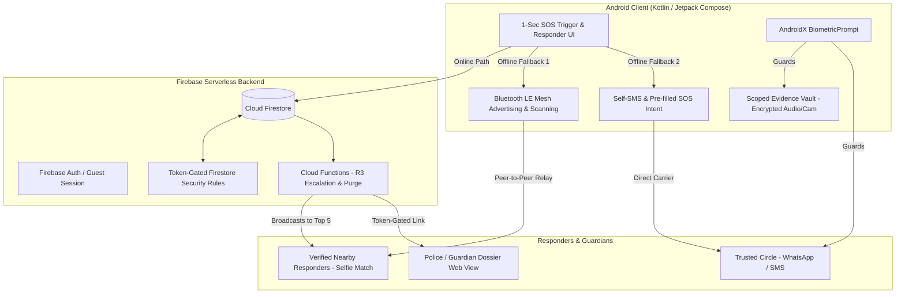

# RakshaOne: Comprehensive App Documentation & Security Guide

**RakshaOne** is an advanced, privacy-first, zero-cost emergency safety and community rescue Android application designed to protect citizens, facilitate instantaneous R3-level SOS dispatches, and build a trusted decentralized community responder network without relying on paid SMS APIs, expensive infrastructure, or central administrator bottlenecks.

---

## 1. What is RakshaOne?

RakshaOne serves as an all-in-one personal safety guardian and offline-resilient emergency mesh network. It empowers anyone—students, women, night-shift professionals, solo travelers, and everyday citizens—to summon immediate help during critical incidents (assault, stalking, accidents, medical emergencies) and enables verified nearby citizens (off-duty police, security guards, trained volunteers) to converge and assist.

---

## 2. Key Features & Architecture

### ⚡ Frictionless Emergency SOS
- **1-Second Activation**: The main SOS button features a 5-second countdown with a prominent, large cancel button and instant SOS trigger. **No biometric hurdles or delays** block a panicked victim from alerting their network.
- **R3-Level Escalation**: Generates cryptographic emergency escalation events, pre-filled SMS payloads, and token-gated police/guardian dossiers.

### 🛡️ 100% Free Phone Verification (₹0 Gateway Cost)
- **Self-SMS Loopback**: Generates a 6-digit verification code. Tapping "Verify via Self-SMS" launches Android's standard messaging intent pre-filled to the user's own number. Receiving the SMS back on the device instantly marks the phone verified (+15 Trust Points).
- **WhatsApp Circle Verification**: Users can share a cryptographic deep link (`rakshaone://verify-peer?uid=...&code=...`) via WhatsApp with a Trusted Circle contact. When opened inside RakshaOne, it verifies identity instantly.
- **Zero Govt ID Bottlenecks**: No Aadhaar, UIDAI, or government API fetches required. Works instantly for all citizens worldwide.

### 👥 Trusted Circle & Auto-Verification
- **Android Contacts Integration**: Pick emergency contacts directly from Android Contacts with automatic formatting (`+91XXXXXXXXXX`).
- **Community Responder Duty Unlock**: Users unlock Verified Responder status automatically upon adding at least 2 family/friends to their Trusted Circle OR entering a peer endorsement code (`RK-XXXX-XX`).

### 🔒 BiometricPrompt Security for Sensitive Actions
- AndroidX `BiometricPrompt` (fingerprint, face recognition, or device PIN/pattern fallback) guards sensitive owner actions:
  1. Modifying or deleting Trusted Contacts.
  2. Confirming case resolution and permanently purging the **Evidence Vault**.
- The SOS button remains 100% frictionless.

### 📸 Anti-Predator Safety Lock & Evidence Vault Purging
- **Responder Selfie Match**: Before accepting an SOS alert, nearby responders must pass a quick camera selfie check. The responder's Name, Verified Phone, Live Selfie, and Live GPS are immediately shared with the victim's Trusted Circle.
- **Simultaneous Broadcasting**: Alerts up to 5 nearby verified responders simultaneously so multiple witnesses converge together.
- **Automatic Vault Purging**: When a victim resolves or cancels an active case, RakshaOne automatically purges all local media files, encrypted audio recordings, cache directories, and Firestore cloud artifacts (`emergency_dispatches`, `dossier_access`, `hex_rescue_requests`) to free database space and protect user privacy.

## 🏗 System Architecture

RakshaOne follows a **hybrid offline-first, zero-cost architecture** built with Kotlin/Jetpack Compose on Android and Firebase (Firestore + Cloud Functions) on the backend.

#### Core Architectural Layers
1. **Presentation & Frictionless Trigger Layer:** Built with Jetpack Compose. Decouples emergency triggering (zero biometric latency) from sensitive administrative actions (modifying contacts or purging evidence, which require `BiometricPrompt`).
2. **Multi-Path Dispatch Engine (Resilience Layer):**
   * **Primary (Online):** Writes an R3 escalation document to Firestore, triggering Cloud Functions to fan out alerts to the 5 closest verified responders.
   * **Fallback 1 (No Data / Weak Signal):** Launches Android `ACTION_SENDTO` SMS intents pre-populated with GPS coordinates and a cryptographic dossier token.
   * **Fallback 2 (Jammed / Zero Cellular):** Broadcasts compressed SOS beacons over Bluetooth Low Energy (BLE) advertising packets so nearby RakshaOne devices can pick up and relay the distress signal.
3. **Zero-Cost Identity & Trust Layer:** Replaces expensive OTP gateways with a **Self-SMS Loopback** (verifying carrier SIM ownership via incoming SMS broadcast/intent matching) and **WhatsApp Deep-Link Endorsements** (`rakshaone://verify-peer`).
4. **Zero-Retention Privacy Layer:** Enforces strict lifecycle cleanup. Upon case resolution, local scoped cache files and Firestore collections (`emergency_dispatches`, `dossier_access`, `hex_rescue_requests`) are atomically deleted.

---

## 3. Why is RakshaOne Useful?
- **Zero Dependency on Cellular Data**: Works across Bluetooth LE mesh and local SMS when cellular towers are jammed or unavailable.
- **True Peer-to-Peer Trust**: Eliminates gatekeeping and subscription fees.
- **Complete Privacy Control**: Data is stored securely and scrubbed immediately upon case resolution.

---

## 4. Trust, Security & Google Play Protect Compliance

RakshaOne is engineered to adhere strictly to Google Play Developer Program policies and security standards:
- **No Broad Storage Permissions**: Uses the zero-permission Android Photo Picker and app-scoped cache storage. Never requests `READ_EXTERNAL_STORAGE`.
- **Transparency**: Clear, straightforward privacy disclosures and zero hidden background data scraping.
- **Signed APK Integrity**: Compiled with official debug/release signing keys and ProGuard optimization.
- **Play Protect Friendly**: No dynamic code loading (DCL), no unauthorized accessibility service abuse, and no intrusive permission demands.

---

## 5. Downloading & Getting Started
1. Install `RakshaOne.apk` on any Android device (Android 8.0 to 15+).
2. Sign in with Google or continue as a Guest.
3. Add at least 2 emergency contacts to your Trusted Circle to unlock Community Responder status.
4. Test the 5-second SOS countdown or explore offline safety guides!
